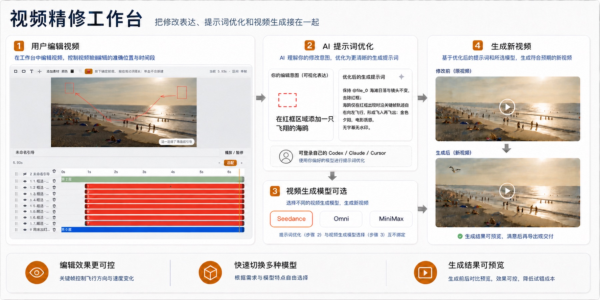
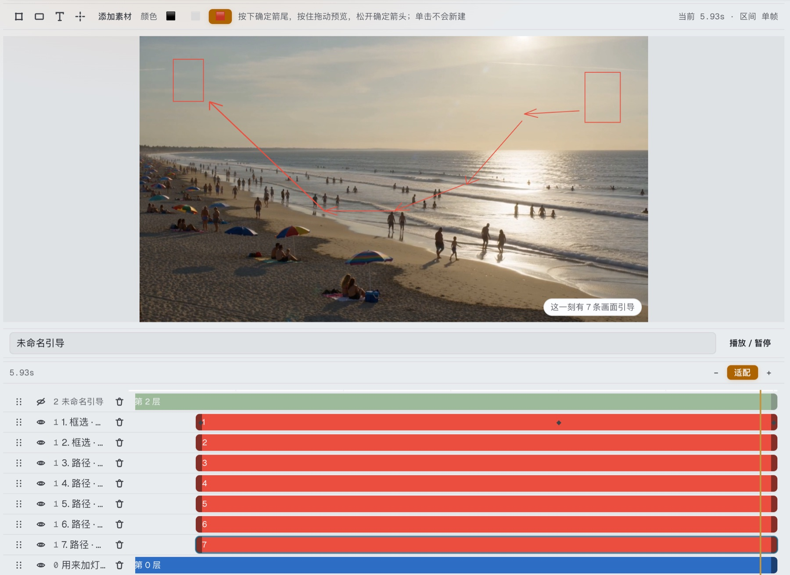

# 视频局部编辑再生成工具（V2）

在原视频上**框选、画箭头**，把「改哪里、怎么改」直接标在画面上，引导 AI 做轻量化局部再生成——背景、角色、关卡画面都可以改，但原片的运镜、节奏与构图不改丢。

## 界面与流程





## 解决什么问题

微调类视频复刻要求「改得准」且「不改丢」：内容可以变，原片的镜头语言必须保留。纯文本或图片引导的方案稳定性不足——文字说不清位置，图片管不住构图。

## 为什么选「标注引导再生成」

| 方案 | 做法 | 实验结论 |
| --- | --- | --- |
| 纯文本引导 | 仅用文字描述修改意图 | 对画面与运镜约束弱，稳定性不足 |
| 图片引导 | 提供参考图引导修改方向 | 比文本稳定，但难以精确指定修改位置 |
| **原视频标注再生成** ✓ | 在原片上框选、画箭头标注后再生成 | 同时覆盖文本与图片引导能力，位置与意图双重可控，稳定性最好 |

纯文本和图片引导本质上都把「改哪里、怎么改」留给模型猜；标注让使用者在画面上直接指明位置和运动方向，模型只需在约束内生成。可控性来自界面交互本身，不依赖提示词水平。

## 工具设计

- **标注引导**：在原视频上框选区域、绘制箭头路径，标注即修改意图；
- **提示词优化**：把标注内容与自然语言描述整理成生成模型友好的提示词；
- **多模型后端**：Seedance / Omni 可选，按任务特点切换；
- **生成对比**：修改前后同屏预览，确认后再导出。

## 运行

```bash
bash run-v2.sh
# 默认 http://127.0.0.1:8788 （V1 在 8787）
```

- Python 3.9+；服务端依赖见 `ZE-video-edit-studio/requirements.txt`
- 视频生成服务地址通过环境变量 `ZE_VIDEOGEN_BASE_URL` 配置
- 运行数据写入 `ZE-video-edit-studio/.data-v2-local/`（不提交 Git）

## 项目结构

```
run-v2.sh                  # 本地启动脚本（注入端口与数据目录）
ZE-video-edit-studio/      # V2 应用源码（Web 工作台 + 服务端）
ZE-video-timeline-domain/  # 共享视频时间轴领域源码
```

## 状态

私有存档。V2 是「图层式视频精修台」的并行体验版：框架、交互与 UI 可运行；引导再生成等 AI 发送路径尚未从 V1 完整移植，**不要把 V2 当前的 AI 路径当成 V1 的等价替代**。
